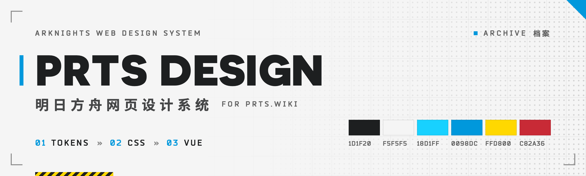

<p align="center">
  <picture>
    <source media="(prefers-color-scheme: dark)" srcset=".github/assets/banner-dark.png">
    
  </picture>
</p>

<p align="center">
  <a href="https://mooncellwiki.github.io/prts-design/">文档站</a> ·
  <a href="https://mooncellwiki.github.io/prts-design/storybook/">Storybook</a> ·
  <a href="https://mooncellwiki.github.io/prts-design/patterns/">整页样例</a>
</p>

# PRTS Design

明日方舟网页设计系统，为 [prts.wiki](https://prts.wiki/) 的新皮肤而做。视觉取自[明日方舟官网](https://ak.hypergryph.com/)与游戏内 UI，分 令牌 → CSS → Vue 三层实现。

- **黑白为体、青为用**：大面积黑 / 白 / 灰，青只做选中、链接与主动作；黄是次强调，红只表示危险。
- **方舟的形状语言**：直角、色条、斜纹、半调网点、角标三角、黑白反转、大写拉丁字；不做圆角，不做辉光。
- **终端 / 档案双主题**：走 MediaWiki 1.43 的 clientPrefs 机制，Codex 令牌桥接到 `--ak-*`。

## NPM 发布包

| 包名 | 说明 |
|---|---|
| [`@mooncellwiki/prts-design-tokens`](https://www.npmjs.com/package/@mooncellwiki/prts-design-tokens) | 令牌源（W3C DTCG），生成 CSS 变量与 `tokens.json` |
| [`@mooncellwiki/prts-design-css`](https://www.npmjs.com/package/@mooncellwiki/prts-design-css) | CSS 实现，框架无关；默认入口 `standalone.css`，不含字体与游戏素材 |
| [`@mooncellwiki/prts-design-vue`](https://www.npmjs.com/package/@mooncellwiki/prts-design-vue) | Vue 3 组件，只输出 `.ak-*` 结构与交互，样式由宿主提供 |

## 使用

- **prts.wiki**：生产皮肤是 [Skin:Arknights](https://github.com/MooncellWiki/mediawiki-skins-Arknights)，它的 `scripts/sync-design-system.sh` 把 `packages/css/src/` 同步过去。CSS 只在本仓库改。见[在 MediaWiki 中使用](https://mooncellwiki.github.io/prts-design/guide/mediawiki)。
- **纯 HTML**：引单文件版，根节点加 `class="ak-scope"`，结构照抄文档站示例的「HTML」页签。见[在纯 HTML 中使用](https://mooncellwiki.github.io/prts-design/guide/html)。

  ```html
  <link rel="stylesheet" href="https://cdn.jsdelivr.net/npm/@mooncellwiki/prts-design-css@0.1/dist/prts-design.min.css">
  ```

- **Vue**：站外 `import "@mooncellwiki/prts-design-css"`，根节点包 `<AkScope>`；prts.wiki 上样式由皮肤加载，别的皮肤下先 `mw.loader.using`。见[在 Vue / prts-widgets 中使用](https://mooncellwiki.github.io/prts-design/guide/vue)。

  ```ts
  import { AkScope, AkButton } from "@mooncellwiki/prts-design-vue";
  ```

## 目录

```
packages/tokens/   令牌源 → tokens.css / tokens.json
packages/css/      CSS 实现：base（MW 内容）· components · decor · arknights · chrome（皮肤骨架）
packages/vue/      Vue 3 组件（示例与 Storybook 共用）
site/              文档站（VitePress）
.storybook/        Storybook
preview/           整页样例（源文件在 _src/，scripts/build-preview.py 生成）
skin/              MediaWiki 皮肤骨架（参考实现）
scripts/           构建脚本、现网数据与第三方快照的抓取脚本
e2e/               Playwright：跨宿主比对 · 计算样式快照 · Storybook 自检
```

完整结构与组件约定见[贡献一个组件](https://mooncellwiki.github.io/prts-design/guide/contributing)。

## 开发

```bash
pnpm install        # Node 24 + pnpm
pnpm dev:docs       # 文档站
pnpm storybook      # Storybook（:6006）
pnpm tokens         # 改了 packages/tokens/src/ 后重新生成令牌
pnpm build          # 构建三个包
pnpm typecheck
pnpm e2e            # 先装一次浏览器：pnpm exec playwright install --only-shell chromium
```

- 改了 `preview/_src/`：`python3 scripts/build-preview.py`
- 改了 `packages/css/src/index.css` 的层序：`node scripts/css-order.ts --write`
- `scripts/fetch-*` 抓现网数据与第三方快照，用法写在各脚本开头

## 发布

三个包用同一个版本号：改 `packages/*/package.json` 的 `version` → 提交 → `git tag vX.Y.Z` → `git push --follow-tags`，由 `.github/workflows/release.yml` 发布到 npm。

## 许可

代码以 [MIT](LICENSE) 授权，npm 包只含这部分。游戏素材（`preview/assets/`、`packages/css/src/img/` 等）版权归鹰角网络所有，不在 MIT 范围内；字体与 `preview/vendor/` 下的第三方代码、现网数据快照按各自目录里的 NOTICE / 许可。
